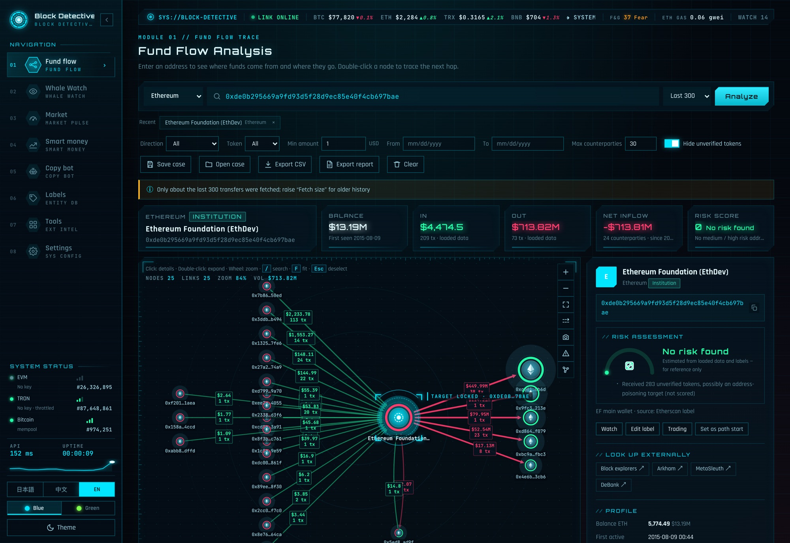
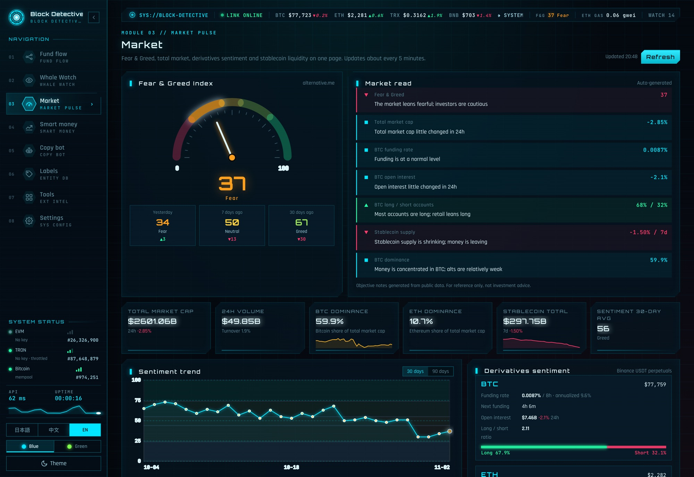

# ブロック探偵（Block Detective）— ローカルで動くマルチチェーン資金フロー分析ツール

[English](README.md) · 日本語 · [中文](README.zh.md) · ライセンス：[AGPL-3.0](LICENSE) · [分析手法](METHODOLOGY.md) · [セキュリティ](SECURITY.md) · [サードパーティ](THIRD_PARTY_NOTICES.md) · 作者：[@FuturEvoLab](https://x.com/FuturEvoLab)

**オンラインデモ：** https://futurevolab.github.io/block-detective/?lang=ja （インストール不要。用意したサンプル事例を閲覧できます）

ウォレットアドレスを入力するだけで、資金が**どこから来て、どこへ流れたか**をグラフで可視化し、1 ホップずつ追跡できる調査ツールです。クジラの監視、スマートマネー（勝率の高いウォレット）の分析、模擬コピートレードによる研究データの蓄積までを、すべて自分のパソコンの中だけで行います。

- **外部ライブラリ不要**：バックエンドは Python 標準ライブラリのみ、フロントエンドは素の JavaScript です。Python 3 があれば動きます。
- **データはローカルに保存**：API キーや分析データを外部サーバーに送ることはありません。
- **3 言語の UI**：日本語（既定）・中文・English





> **免責事項**：本ツールは調査・学習用です。スコア、解説、バックテスト、シミュレーションの結果はいずれも公開データからの推定であり、誤りを含む可能性があります。**投資助言ではありません。** コピートレード機能は模擬の記帳のみを行い、実際の注文は出しません。利用は自己責任で、各国の法令と各データ提供元の利用規約に従ってください。

## 主な機能

| 機能 | 内容 |
|---|---|
| 資金フロー図 | 入金を左、出金を右に配置したグラフを表示します。ダブルクリックで次の階層へ展開でき、残高・初回取引日・最初の資金元も確認できます。CSV、PNG、HTML 調査レポートの出力と、調査状態の保存・復元に対応します。 |
| リスクスコア（0〜100） | ハッカー、ミキサー、制裁対象などとの取引を、最大 3 ホップまで減衰させながら伝播させて採点します。中継や分割送金といった行動パターンも加点します。OFAC SDN のアドレスリストをワンクリックで取り込めます。 |
| 資金経路の追跡 | A から B への資金経路（最大 6 ホップ）を探索し、ボトルネック金額と時系列の整合性をチェックします。 |
| クジラ監視 | 大口送金をバックグラウンドで検知し、macOS 通知または Webhook（Telegram、Discord、Slack、任意の HTTPS URL）で知らせます。アドレスごとに金額・方向・トークンの条件を設定できます。監視中アドレス全体の 24 時間 / 7 日間の純流入もまとめて表示します。ブラウザを開いておく必要はありません。 |
| マーケット | Fear & Greed 指数、時価総額、先物の資金調達率と建玉、ステーブルコイン供給量、主要銘柄の動きを一画面にまとめ、客観的な解説を自動生成します。 |
| スマートマネー分析 | ウォレットの DEX 売買を再構築し、何を買ったか、実現・含み損益、勝率、評価（S〜D）を算出します。ボットの判定、トークンの購入者からの候補探索、ランキングからの一括インポートにも対応します。 |
| コピートレード（模擬）・**Pro** | ガス代と価格インパクトを考慮した模擬売買を行います。高値追い、ハニーポット、流動性の引き抜き（ラグプル）などへの対策ルールを備えています。 |
| 研究データとバックテスト・**Pro** | 各シグナルの特徴量と、その 1 時間後〜7 日後の値動きを SQLite に記録します。過去 45 日のバックテストと 640 通りのパラメータ探索も実行できます。 |

**Pro** は商用拡張の機能です。クローズドソースで別途配布し、`ext/` フォルダに置いて使います（[ライセンス](#ライセンス) を参照）。それ以外はすべてこのリポジトリに含まれます。

各スコアの計算方法は [METHODOLOGY.md](METHODOLOGY.md) にまとめています。

## 技術的なポイント

- **依存ゼロのフルスタック構成**
  - サーバー：`ThreadingHTTPServer` を使った約 2,700 行の Python
  - フロント：約 4,000 行の Vanilla JS と Cytoscape.js
  - ビルド工程はなく、ファイルをコピーするだけで動きます。
- **10 以上の外部 API の統合**
  - Etherscan V2、Blockscout、TronGrid、mempool.space、CoinGecko、DexScreener、GeckoTerminal、GoPlus、Binance、DefiLlama などを利用しています。
  - API ごとにレート制限、429 応答時の再試行、キャッシュを実装しています。
- **体感速度の最適化**
  - インメモリとディスク（gzip）の 2 段キャッシュに、stale-while-revalidate を組み合わせました。サーバー再起動直後の初回表示を 3.7 秒から 4 ミリ秒に短縮しています。
  - 取得を並列化し、届いたデータから順に描画します。グラフの更新も差分のみです。
- **オンチェーン分析のアルゴリズム**
  - 同一トランザクション内の入出金から DEX の売買を復元し、平均原価法で損益を計算します。
  - リスクスコアは、取引額・取引比率・方向で重み付けしながらグラフ上を伝播させます。
  - ボット判定には 6 種類の行動特徴量を使っています。
- **データ取得の堅牢性**
  - Etherscan で内部トランザクションの反映が遅れても売りシグナルを取りこぼさないよう、30 分の遡り再走査と重複排除を行っています。
  - 取得が不完全な場合はチェックポイントを進めない設計です。
  - これらの挙動を自動テスト（`tests/`：コピートレードのシナリオに加え、売買の復元、バックテスト、入力検証、DNS リバインディング／CSRF 対策の単体テスト）で検証し、push ごとに GitHub Actions で実行しています。
- **セキュリティ**
  - Host と Origin の検証により、DNS リバインディングと CSRF を防いでいます。
  - CSP でインラインスクリプトを禁止し、悪意あるトークン名による XSS を全画面で注入テストしました。
  - CSV の数式インジェクション対策を入れています。
  - API キーは macOS キーチェーンに保存できます。
- **運用面**
  - launchd による常駐と、異常終了時の自動再起動に対応しています。
  - 内蔵ディスクへの日次バックアップ（14 日分保持）を行っています。
  - 画面からワンクリックで再起動でき、最新コードを読み込みます。
  - Windows でもダブルクリックで起動できます。
- **i18n**
  - 辞書と正規表現パターン、MutationObserver を組み合わせて、動的に生成される画面も含めて 3 言語に切り替えます。
- **静的デモ**
  - `fetch` を差し替えて、記録済みのサンプルデータで応答します。バックエンドなしで GitHub Pages 上で動きます（`tools/build_demo.py`）。

## クイックスタート

- **macOS**：`启动区块侦探.command` をダブルクリックすると、ブラウザで http://127.0.0.1:8765 が開きます。初回にブロックされた場合は、右クリック →「開く」を選んでください。
- **Windows**：Python 3 をインストールし（「Add python.exe to PATH」にチェック）、`启动区块侦探.bat` をダブルクリックします。
- **共通**：プロジェクトのフォルダで `python3 server.py` を実行し、http://127.0.0.1:8765 を開きます。
- **常駐（macOS、任意）**：`安装开机自启.command` をダブルクリックすると、ログイン時に自動で起動します。解除するときは `取消开机自启.command` を実行してください。

初回起動時に、公開情報にもとづく既知アドレスのラベル 44 件（取引所、機関、公開報道されたセキュリティ事件の関連アドレスなど）と、監視リストの例 14 件が `seed/` から読み込まれます。

### API キー（「設定」画面で入力）

| 対象 | データ元 | キー |
|---|---|---|
| Ethereum / Polygon / Arbitrum | Etherscan V2 | **必須**。https://etherscan.io/apis で無料登録できます（BSC と Base は有料プラン） |
| Optimism | Blockscout | 任意。キーなしでは 1 時間に約 10 回までです。https://dev.blockscout.com で無料登録できます |
| TRON | TronGrid | 任意。キーなしでは毎秒 1 回に制限されます |
| Bitcoin・価格・マーケット | mempool.space、CoinGecko など | 不要 |

更新履歴：[CHANGELOG.md](CHANGELOG.md)

## 構成

```
server.py               バックエンド（Python 標準ライブラリのみ）：外部 API、ローカル保存、バックグラウンド処理
static/                 画面（Vanilla JS）。app.js が資金フロー図、risk / path / market / smart / report.js が各機能、i18n.js が 3 言語辞書
ext/                    拡張（リポジトリには含めません）。ext/<名前>/__init__.py の register(core, ext) を起動時に読み込みます。
                        商用の Pro 拡張（コピーボット、バックテスト、研究データ）はここに置きます
seed/                   初回起動時に data/ へコピーする既知アドレスのラベルと監視リストの例
tests/                  単体テスト（python3 -m unittest discover tests）
tools/build_demo.py     GitHub Pages 用の静的デモを生成
docs/                   生成済みのオンラインデモ
assets/                 README 用のスクリーンショット
data/                   実行時データ（API キー、ラベル、研究 DB など）。リポジトリには含めません
```

## 制限事項

- 各アドレスについて取得するのは直近約 1,000 件の送金で、全履歴ではありません。
- アドレスのクラスタリング（同一人物の判定）は行いません。
- 資金フロー図の USD 換算には現在価格を使います。
- トークン同士の直接交換は、スマートマネー分析の損益計算の対象外です。
- Solana と Base は未対応です（それぞれ Helius、Alchemy のキーが必要になります）。

## ライセンス

このリポジトリのコア部分は [GNU AGPL-3.0](LICENSE) です。自由に利用・改変・再配布できます。本プロジェクトをもとにネットワークサービスを提供する場合は、改変したソースコードを同じライセンスで公開する必要があります。

**Pro 拡張**（コピートレード・シミュレーター、バックテストとパラメータ探索、研究データベース、ウォレットの自動探索）はプロプライエタリです。ライセンスをお持ちの方に `ext/pro/` 用のフォルダとして別途配布しており、このリポジトリには含まれません。入手については作者までご連絡ください。分離前に公開したバージョンには同じコードが AGPL-3.0 で含まれており、その条件のもとで引き続き利用できます。

既知アドレスのラベルは Etherscan の公開ラベルと報道にもとづいています。「待核实（要確認）」とあるものは、ご自身で確認してください。各データ提供元の利用規約に従ってご利用ください（多くの無料枠は非商用に限られます）。

## 作者

FuturEvoLab — X（Twitter）：[@FuturEvoLab](https://x.com/FuturEvoLab)。質問や提案は GitHub の Issue、または X の DM でお気軽にどうぞ。

本プロジェクトは AI ペアプログラミング（Claude Code）の支援を受けて開発しました。機能設計・要件定義・判断・レビューは FuturEvoLab が行っています。
