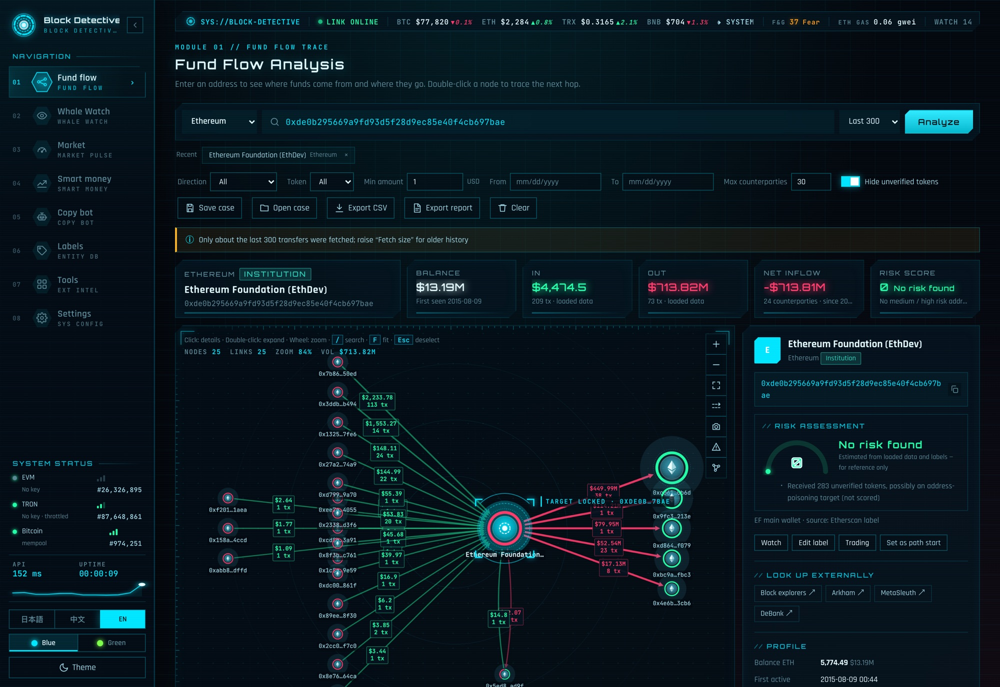
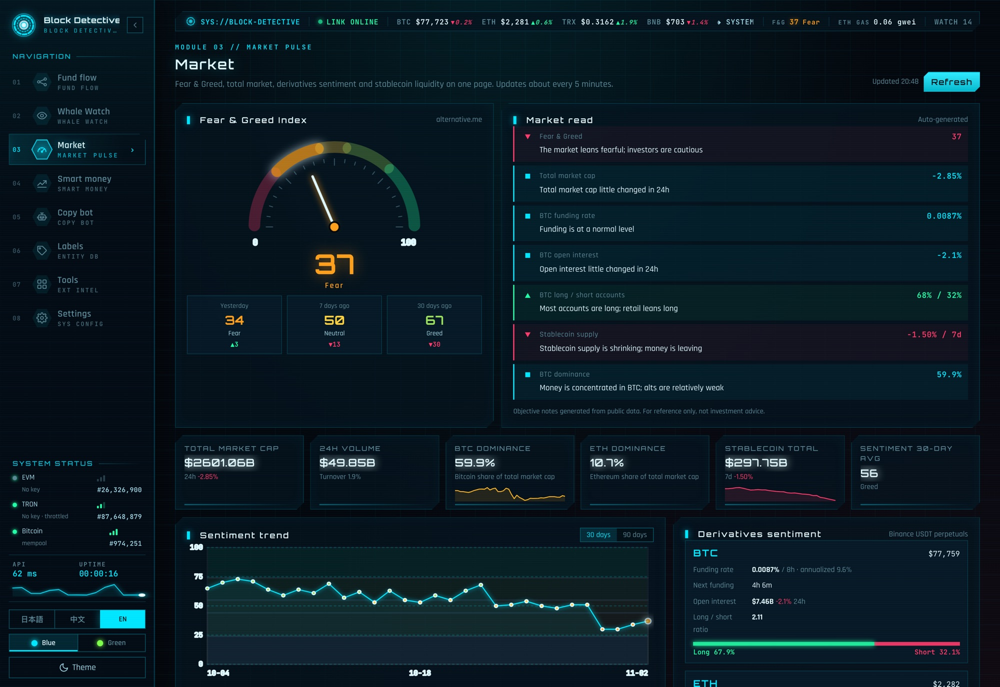

# Block Detective — local multi-chain fund-flow investigator

English · [日本語](README.ja.md) · [中文](README.zh.md) · License: [AGPL-3.0](LICENSE) · [Methodology](METHODOLOGY.md) · [Security](SECURITY.md) · [Third-party notices](THIRD_PARTY_NOTICES.md) · Author: [@FuturEvoLab](https://x.com/FuturEvoLab)

[](https://github.com/FuturEvoLab/block-detective/actions/workflows/tests.yml)    

**Online demo:** https://futurevolab.github.io/block-detective/?lang=en (no install; browse a preset sample case)

Paste a wallet address to see **where the money came from and where it went** as a graph, then trace it hop by hop. Block Detective also watches whales, analyzes smart-money wallets (wallets with a high win rate) and runs a copy-trading **simulator** that builds a research dataset. Everything runs on your own computer.

- **No dependencies.** The backend uses only the Python standard library; the frontend is plain JavaScript. Python 3 is all you need.
- **Your data stays local.** API keys and analysis data are never sent to any server of ours.
- **Three UI languages:** Japanese (default), Chinese and English.





> **Disclaimer.** This is a research and learning tool. Scores, market notes, backtests and simulations are estimates from public data and may be wrong. **Nothing here is investment advice.** The copy-trading feature only keeps a simulated ledger and never places real orders. Use it at your own risk, and follow your local laws and each data provider's terms of use.

## Features

| Feature | What it does |
|---|---|
| Fund flow graph | Inflows on the left, outflows on the right. Double-click a node to expand the next hop. Shows balance, first activity and first funder. Exports CSV, PNG and an HTML investigation report; cases can be saved and reopened. |
| Risk score (0–100) | Exposure to hacker-labelled, mixer and sanctioned addresses is propagated over up to 3 hops with damping. Behaviour patterns such as pass-through and split transfers add to the score. |
| Path tracing | Finds how funds moved from A to B (up to 6 hops), with the bottleneck amount and a time-order check. |
| Whale watch | Detects large transfers in the background and sends macOS notifications or a webhook (Telegram, Discord, Slack or any HTTPS URL). Per-address rules: amount threshold, direction, token list. The browser doesn't need to stay open. |
| Market | Fear & Greed, total market cap, futures funding and open interest, stablecoin supply and major coins on one page, with an objective, auto-generated market read. |
| Smart money | Rebuilds a wallet's DEX trades: what it bought, realized and unrealized P&L, win rate and grade (S–D). Includes bot detection, discovering wallets from a token's buyers, and bulk import from leaderboards. |
| Copy-trading (simulated) · **Pro** | Simulated trades that account for gas and price impact, with rules against chasing pumps, honeypots and liquidity pulls (rug pulls). |
| Research data and backtests · **Pro** | Records each signal's features and its price move 1 hour to 7 days later in SQLite. Runs a 45-day backtest and a 640-combination parameter search. |

**Pro** marks features of the commercial extension: it is closed source, distributed separately and plugs into the `ext/` folder (see [License](#license)). Everything else is in this repository.

How every score is computed: [METHODOLOGY.md](METHODOLOGY.md).

## Technical highlights

- **Zero-dependency full stack**
  - Server: about 2,700 lines of Python on `ThreadingHTTPServer`.
  - Frontend: about 4,000 lines of vanilla JS plus Cytoscape.js.
  - No build step: copy the files and it runs.
- **10+ external APIs integrated**
  - Etherscan V2, Blockscout, TronGrid, mempool.space, CoinGecko, DexScreener, GeckoTerminal, GoPlus, Binance, DefiLlama and more.
  - Each API has its own rate limiting, retry on HTTP 429, and caching.
- **Perceived speed**
  - Two-tier cache (in-memory and gzip on disk) with stale-while-revalidate. First paint right after a server restart went from 3.7 s to 4 ms.
  - Requests run in parallel and the page renders data as it arrives; graph updates are incremental.
- **On-chain analysis algorithms**
  - DEX trades are reconstructed from the inflows and outflows inside one transaction; P&L uses the average-cost method.
  - The risk score propagates over the graph, weighted by amount, share of volume and direction.
  - Bot detection uses six behavioural features.
- **Robust data collection**
  - A 30-minute look-back rescan with de-duplication, so sell signals aren't missed when Etherscan indexes internal transactions late.
  - Checkpoints never advance after an incomplete fetch.
  - These behaviours are covered by automated tests (`tests/`: the copy-bot scenario plus unit tests for trade reconstruction, the backtest engine, input validation and the DNS-rebinding / CSRF guard), run on every push by GitHub Actions.
- **Security**
  - Host and Origin checks block DNS rebinding and CSRF.
  - CSP forbids inline scripts, and every page was injection-tested against XSS through malicious token names.
  - CSV formula-injection protection.
  - API keys can be stored in the macOS Keychain.
- **Operations**
  - Runs as a launchd agent and restarts automatically after a crash.
  - Daily backups to the internal disk, keeping 14 days.
  - One-click restart from the UI to load the latest code.
  - Double-click launcher on Windows too.
- **i18n**
  - Dictionaries, regex patterns and a MutationObserver switch the whole UI between three languages, including dynamically generated content.
- **Static demo**
  - Replaces `fetch` to answer from recorded sample data, so the UI runs on GitHub Pages with no backend (`tools/build_demo.py`).

## Quick start

- **macOS:** double-click `启动区块侦探.command` ("start Block Detective"). The browser opens http://127.0.0.1:8765. If macOS blocks it the first time, right-click the file → Open.
- **Windows:** install Python 3 from python.org (tick "Add python.exe to PATH"), then double-click `启动区块侦探.bat`.
- **Any OS:** run `python3 server.py` in the project folder and open http://127.0.0.1:8765.
- **Run at login (macOS, optional):** double-click `安装开机自启.command` ("install auto-start"). To undo, run `取消开机自启.command` ("remove auto-start"). The simulator, alerts, daily backups and wallet discovery only keep working while the server runs.

The UI starts in Japanese; switch to English with the **EN** button at the bottom of the sidebar.

On first run, `seed/` provides 44 publicly known address labels (exchanges, institutions, addresses linked to publicly reported security incidents and others; check the ones marked "to verify") and 14 example watchlist entries.

### API keys (Settings page)

| Chain or data | Source | Key |
|---|---|---|
| Ethereum, Polygon, Arbitrum | Etherscan V2 | **Required.** Free at https://etherscan.io/apis. BSC and Base need a paid plan. |
| Optimism | Blockscout | Optional; without a key you get about 10 requests per hour. Free at https://dev.blockscout.com |
| TRON | TronGrid | Optional; without a key it is limited to 1 request per second. |
| Bitcoin, prices, market data | mempool.space, CoinGecko and others | Not needed |

Version history: [CHANGELOG.md](CHANGELOG.md).

## Project layout

```
server.py               Backend (Python standard library only): external APIs, local storage, background jobs
static/                 UI (vanilla JS). app.js is the fund-flow graph; risk / path / market / smart / report.js are the
                        other features; i18n.js holds the three-language dictionary
ext/                    Extensions (not committed). Each ext/<name>/__init__.py with register(core, ext) is loaded at
                        startup; the commercial Pro extension (copy bot, backtests, research) is installed here
seed/                   Known-address labels and example watchlist copied into data/ on first run
tests/                  Unit tests (python3 -m unittest discover tests)
tools/build_demo.py     Builds the static GitHub Pages demo
docs/                   The generated online demo
assets/                 README screenshots
data/                   Runtime data (API keys, labels, research DB…); never committed
```

## Development

- After editing `server.py`, use **Settings → Service → Restart service** to reload. Changes in `static/` only need a browser refresh.
- To add a translation, add a `["中文", "日本語", "English"]` row to `ENTRIES` in `static/i18n.js`.
- Run the tests with `python3 -m unittest discover tests` (no network, uses a temporary data folder) and `node --test tests/test_risk.js tests/test_path.js tests/test_i18n.js` for the browser-side risk score, path tracing and the translation layer. `python3 tools/i18n_check.py` lists UI strings that still lack translations. A non-zero exit code means a check failed.
- Extensions: drop a folder into `ext/` with an `__init__.py` defining `register(core, ext)`. It can add API routes (`ext.route`), hook into the background checks (`ext.on`) and add a page to the UI (`ext.page`); the available hooks are listed in `HOOKS` in `server.py` and `tests/test_core.py` has a minimal example. See [CONTRIBUTING.md](CONTRIBUTING.md) before opening a pull request.

## Limitations

- Only the latest ~1,000 transfers per address are loaded, not the full history.
- There is no address clustering (no "same owner" detection).
- USD values in the fund-flow graph use current prices.
- Token-to-token swaps are not priced in the smart-money analysis.
- Solana and Base are not supported yet (they would need Helius and Alchemy keys).

## License

The core in this repository is [GNU AGPL-3.0](LICENSE). You may use, modify and redistribute it freely. If you offer it as a network service, you must publish your modified source under the same license.

The **Pro extension** (copy-trading simulator, backtests and parameter search, research database, daily wallet discovery) is proprietary. It is distributed separately to licensed users as a folder for `ext/pro/` and is not part of this repository; contact the author for access. Versions of this repository published before the split still contain that code under AGPL-3.0, and may be used under those terms.

Known-address labels come from Etherscan's public labels and news reports. Please verify the ones marked "待核实" (to verify) yourself. Follow each data provider's terms of use (most free tiers are non-commercial only).

## Author

FuturEvoLab — X (Twitter): [@FuturEvoLab](https://x.com/FuturEvoLab). Questions and suggestions are welcome via GitHub Issues or X DMs.

This project was developed with AI pair-programming assistance (Claude Code). Feature design, requirements, decisions and review are by FuturEvoLab.
