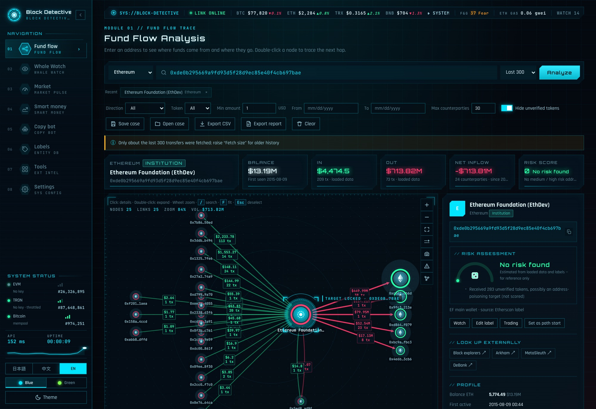
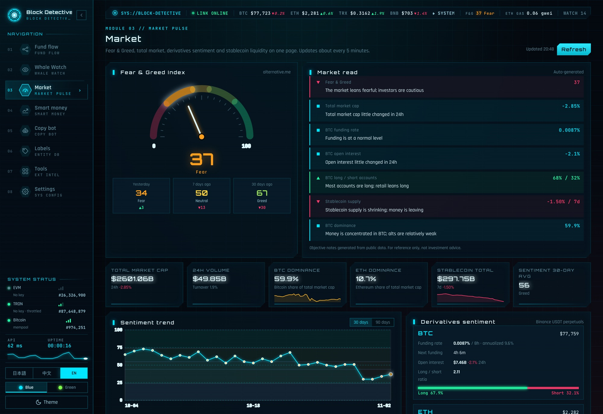

# 区块侦探 Block Detective — 本地多链地址资金流向分析工具

[English](README.md) · [日本語](README.ja.md) · 中文 · 许可证：[AGPL-3.0](LICENSE) · [方法说明](METHODOLOGY.md) · [安全说明](SECURITY.md) · [第三方组件](THIRD_PARTY_NOTICES.md) · 作者：[@FuturEvoLab](https://x.com/FuturEvoLab)

**在线演示：** https://futurevolab.github.io/block-detective/?lang=zh（不用安装，可以浏览预置的示例案例）

在自己电脑上运行，输入地址就能看到资金**从哪来、到哪去**，可以逐层展开追踪，也能监控巨鲸地址、分析聪明钱、模拟跟单并积累研究数据。
只依赖 Python 3（macOS 自带或已安装即可），**不需要装任何第三方包**。所有数据和 API Key 都只保存在你自己的电脑上。





> **免责声明**：本工具仅供研究和学习，所有评分、解读、回测和模拟结果都是基于公开数据的估算，可能有误，**不构成任何投资建议**。跟单功能只做模拟记账，不会下真实订单。使用者需自行承担风险，并遵守所在地的法律法规和各数据源的使用条款。

## 启动

- **双击** `启动区块侦探.command`，浏览器会自动打开 http://127.0.0.1:8765（已开机自启时只打开浏览器）
  （第一次双击如果被 macOS 拦截：右键 → 打开）
- 或在终端运行：

```bash
cd 区块侦探所在的文件夹 && python3 server.py
```

关闭终端窗口即停止。工具只监听本机 127.0.0.1，局域网里的其他人访问不到。

## 一键启动 / 查看修改结果
- **Mac**：双击 `启动区块侦探.command`（已在后台运行时只打开浏览器）。
- **Windows**：把整个文件夹拷到 Windows 电脑，先安装 Python 3（https://www.python.org/downloads/ ，安装时勾选 “Add python.exe to PATH”），然后双击 `启动区块侦探.bat`。会检查服务是否已运行、自动启动并打开浏览器；关闭那个黑色窗口即停止。Windows 上没有系统通知和开机自启，备份放在 `%APPDATA%\BlockDetective\backups`。
- **网页里一键重启**：改了代码之后，到“设置 → 服务”点“重启服务（加载最新代码）”，几秒后页面自动刷新，就能看到修改结果（Mac、Windows 都适用）。只改了网页文件（`static/` 里的）时直接刷新浏览器即可。

## 开机自启（Mac，可选）
双击 `安装开机自启.command`，服务就会**登录 Mac 后自动在后台运行**，意外退出会在 30 秒内自动重启，所以跟单机器人、后台提醒、每天的钱包扩充和备份会一直工作，不需要开着终端窗口。
- 打开界面：双击 `启动区块侦探.command`（服务已在运行时只会打开浏览器），或直接访问 http://127.0.0.1:8765
- 运行日志：`~/Library/Logs/BlockDetective/server.log`
- 改了 `server.py` 之后要重启服务才生效：

```bash
launchctl kickstart -k gui/$(id -u)/com.blockdetective.server
```

- 取消开机自启：双击 `取消开机自启.command`（会停止后台服务并删除 `~/Library/LaunchAgents/com.blockdetective.server.plist`）。
- 如果项目放在外接硬盘上，硬盘没插上时服务起不来，会每 30 秒重试一次，插上后自动恢复。

## 安全与备份
- **只接受本机访问**：服务只监听 127.0.0.1，并且检查每个请求——Host 不是 `127.0.0.1` / `localhost` 的（防“DNS 重绑定”：恶意网站把自己的域名解析到本机来读数据）、或者浏览器标明来自其他网站的（防 CSRF：别的网页偷偷发请求改设置、删标签），一律拒绝并记进日志（`blocked ...`）。命令行工具（curl、脚本）不受影响。
- **防恶意数据**：代币名、标签、案件文件里的内容都可能被人动手脚（任何人都能发一个名字带网页代码的币到你监控的地址）。所有显示的外部数据都会转义；页面还启用了内容安全策略（CSP），只运行本站的脚本文件，就算哪里漏了转义，注入的代码也不会执行；链接里的地址和哈希会编码；导出 CSV 时以 `= + - @` 开头的文字会加 `'`，防止 Excel 当公式执行；页面禁止被其他网站嵌入。
- **API Key 加密保存（Mac，需手动开启）**：默认 Key 明文存在 `data/config.json`（如果项目放在外接硬盘上，硬盘没有权限控制，插到别的电脑上就能读）。到“设置”页点“移到 macOS 钥匙串（推荐）”，Key 会存进系统钥匙串（加密，登录后才能读），同时删掉 `config.json` 和所有备份里的明文；之后在设置页保存新 Key 也会直接存进钥匙串。Windows 没有钥匙串，仍存在 `config.json`。
- **下载 / 恢复备份**：设置页可把 data/ 的全部数据（不含缓存和 API Key）下载成一个 zip；在新机器上用"从 zip 恢复"导入（会先自动备份当前数据，恢复后服务自动重启）。
- **每天自动备份**：标签库、监控列表、设置（含 API Key）、排行榜、模拟账本和研究数据库，每天备份到 Mac 内置硬盘 `~/Library/Application Support/BlockDetective/backups/日期/`，保留最近 14 天；“设置”页可以查看和立即备份。恢复时把需要的文件复制回 `data/`，再重启服务。
- **版本管理**：`data/`（API Key 和运行数据）不进版本库。第一次运行时会从 `seed/` 复制预置的知名地址标签和示例监控列表。

## 界面语言
支持 **日本語 / 中文 / English**，默认日语。左侧菜单栏底部或“设置”页可以切换，选择会被记住。
翻译词典在 `static/i18n.js`：`ENTRIES` 是固定文案，`PATTERNS` 是带数字等变量的文案，`GLOSSARY` 是标签数据里常见词的术语替换（只影响显示，不改存储的数据）。新增界面文字时，在 `ENTRIES` 里加一行“中文, 日本語, English”即可。

## 配色
支持**蓝色（冰蓝全息，默认）**和**绿色（荧光矩阵）**两套配色，在左侧菜单栏底部或“设置”页切换，选择会被记住。绿色配色下“流入”改用青绿色，避免和主色混淆；流出仍是红色。所有发光、边框、面板底色都跟着主色走，资金图和行情图切换后会自动重画。

## 第一次使用：填 API Key

| 链 | 数据源 | 需要 Key？ |
|---|---|---|
| Ethereum / BSC / Polygon / Arbitrum / Base / Optimism | Etherscan V2 | **需要**，免费注册：https://etherscan.io/apis （2026-10 实测：免费 Key 可查 **Ethereum、Polygon、Arbitrum**；**BSC、Base、Optimism 需付费套餐**） |
| TRON | TronGrid | 可选。不填也能用，但每秒只能请求 1 次，速度较慢。免费注册：https://www.trongrid.io |
| Bitcoin | mempool.space | 不需要 |
| 价格 | CoinGecko | 不需要 |

在网页的“设置”页填写。Key 只保存在本机 `data/config.json`。

## 功能

### 1. 资金流向（主界面）
- 输入地址后点“分析”。链类型会自动识别：T 开头是 TRON，bc1/1/3 开头是 BTC，0x 开头是 EVM（默认 ETH，查其他 EVM 链请在下拉框里选）。
- **图怎么看**：中心金色节点是查询的地址；**左边是资金来源（绿线），右边是资金去向（红线）**，下方是有来有往的地址。线越粗金额越大，线上标的是美元合计和笔数。
- **双击任意节点**会展开它的资金流，继续追踪下一层。两个已展开地址之间的连线是紫色。
- 单击节点，右侧显示地址档案：余额、**首次活跃时间**、**最初资金来源**（谁给它转的第一笔钱，EVM 链才有，这是很重要的线索）、主要对手方，以及打开 Arkham / MetaSleuth / 区块浏览器的外部链接。
- 单击连线，可以看到两个地址之间的逐笔转账。
- **活动时间线**：按天、周或月显示流入流出柱状图，用来看地址的活跃周期。
- **过滤**：方向、代币、最小金额、日期范围。“隐藏未验证代币”默认开启，用来过滤“地址投毒”的假 USDT 和垃圾币。
- 可以**导出 CSV**（Excel 直接打开），也可以用图右上角的相机按钮把资金图**导出成高清 PNG**，方便放进报告。
- 明细表右上角有搜索框，可以按地址、名称、交易哈希或代币筛选。
- 搜索框下方会记住**最近查询**的 8 个地址，点一下就能重新分析。
- 快捷键：`/` 跳到搜索框，`F` 让资金图适应窗口，`Esc` 取消选择，数字键 `1`～`8` 切换页面。
- **保存案件 / 打开案件**：把当前调查（已展开的地址、全部转账数据、节点位置、过滤条件）存成一个 JSON 案件文件，之后打开就能完整还原。案件里的数据是保存当时的快照，想看最新情况就重新分析。
- **资金路径追踪**：在一个地址的详情里点“设为路径起点”，再到另一个地址点“追踪到这里”，就会在已加载的数据里找出资金从起点流到终点经过的中转地址（最多 6 跳），并在图上用金色高亮。每条路径会标出跳数、**瓶颈金额**（路径上最小一段的金额，表示最多可能有多少资金沿这条路走过）和**时间顺序是否成立**（每一段都能找到晚于上一段的转账）。点路径卡片可切换，按 `Esc` 或“清除路径”取消。找不到路径时，先双击展开中间的地址加载更多数据。
- **导出调查报告**：点“导出报告”生成一个独立的 HTML 文件，里面有风险评估、关键指标、资金流向图、资金路径、主要对手方、图中的中高风险地址、大额转账和按月汇总，可以直接发给别人，或在浏览器里打印成 PDF。报告语言跟随界面语言。
- **本地缓存**：查过的地址会在本机缓存 10 分钟（`data/cache/`，重启后仍有效），重复查询瞬间打开，也更省 API 额度；接口临时失败时会自动用旧缓存兜底并提示。想拿最新数据，**按住 Shift 点“开始分析”**即可强制刷新。缓存保留 7 天、最多 1500 个文件，会自动清理。
- **节点怎么看**：外圈刻度（金色 = 监控中）；中间环形表示流入（绿）和流出（红）的占比，红绿各半往往是中转地址；中心是分类图标，未标记的地址显示所在链的标志；节点越大，资金越多。连线上的流动速度越快，金额越大。

### 风险评分
- 每个地址都会自动算出 0～100 的风险分：**高（≥75）/ 中（≥40）/ 低（≥15）**。中、高风险节点右上角有橙色或红色警示三角，光晕也会变成对应颜色。
- 计算依据（只用已经加载的数据和标签库，不额外调用接口）：
  - 标签为黑客、混币器、嫌疑人、风险的地址是**风险源**，备注里有“制裁 / 被盗 / 钓鱼 / 诈骗”等字样的也算。
  - 和风险源有直接资金往来的地址会被传染；经未标记地址中转的间接关联每隔一层打五折，最多追 3 层。收到风险资金比转给风险地址更严重，往来金额和占比越大分数越高，几美元的粉尘只算很少。
  - 已展开的地址还会检查行为特征：快进快出（疑似中转）、少量流入后分散转出（疑似拆分）、新地址却有大额往来。
  - 交易所、机构、做市商、合约等已知实体不会向外传播风险，自身分数最高 30 分。
- 在哪里看：右侧详情的“风险评估”（仪表盘和逐条原因，点原因里的地址可在图上定位）、顶部 KPI 的“风险评分”、悬停卡的 RISK、明细表对手方旁边的风险标签。
- 图右侧工具栏的**警示三角按钮**是“风险视图”：只突出中高风险地址和与它们相连的线，其他变暗。
- 这是基于标签和已加载数据的估算，**标签库越完整越准**；结论请结合 MistTrack、Arkham 等平台核实。

### 2. 巨鲸监控
- **监控规则**：每个地址可以设大额阈值、只看流入或只看流出、只看某些代币（如 `USDT, ETH`）。再次添加同一地址就是更新规则。
- **后台大额提醒**：在“巨鲸监控”页开启后，本地服务会按设定间隔（5～60 分钟）在后台检查监控列表，发现超过阈值的新转账就推送 **macOS 系统通知**，**网页不用开着**，只要区块侦探服务在运行即可（关掉启动它的终端窗口就停止）。第一次检查只记录当前位置，不会把历史转账当成新提醒。通知语言跟随界面语言。提醒记录保存在 `data/alerts.json`。
  - **聪明钱买入提醒**（默认开启）：同一个后台检查也会查看所有分类为“聪明钱”的钱包，发现它们新买入代币（金额 ≥ 设定的最低金额，默认 $1,000）就推送通知，例如“某钱包 买入 PEPE $5.2K（首次）”。“首次”表示在最近约 200 笔转账里第一次买这个代币；可以勾选“只提醒首次买入的代币”减少打扰。要让钱包进入跟踪，到“聪明钱”页分析后点“标为聪明钱”。
  - 如果点“发送测试通知”后没看到通知：打开“系统设置 → 通知”，允许“脚本编辑器（Script Editor）”发送通知。
- 添加想跟踪的地址，设置“大额阈值”（美元）。
- 点“立即刷新”会拉取每个地址最近 50 笔转账，合并成一条时间线。上次检查之后出现的标“新”，超过阈值的标“大额”并高亮。
- 可以开启自动刷新（5 或 15 分钟一次，页面需要保持打开）和桌面通知。
- 点“分析”跳到资金流向图，查看这个地址的完整去向和履历。

- **Webhook 通知**（设置页，可选）：大额和聪明钱买入提醒也推送到 Telegram / Discord / Slack 或任意 HTTPS 地址——Windows / Linux 上就靠它收提醒。地址里含密钥，按 API Key 的方式保存；可发测试通知、看最近发送状态。

### 3. 市场监控
- **恐惧与贪婪指数**：仪表盘显示当前值和区间（极度恐慌 / 恐慌 / 中性 / 贪婪 / 极度贪婪），并和昨天、7 天前、30 天前对比；下方有 30 / 90 天走势图，鼠标悬停可看每天的数值。顶部状态栏也会一直显示 F&G 读数，点击即可进入本页。
- **市场解读**：根据情绪、全市场市值涨跌、BTC 资金费率、合约持仓变化、多空账户比、稳定币供应和 BTC 市占率自动生成客观描述，仅供参考，不构成投资建议。
- **全市场概览**：总市值、24h 成交额和换手率、BTC / ETH 市占率、稳定币总量及 7 天变化、情绪 30 日均值。
- **合约情绪**：BTC / ETH 永续合约的资金费率（含年化）、下次结算时间、持仓量及 24h 变化、多空账户比。
- **主流币行情**：市值前 15 的价格、24h / 7d 涨跌、市值、成交额和 7 日走势小图。
- 数据来源都是免费公开接口，不需要 Key：alternative.me（恐惧与贪婪）、CoinGecko（市值和行情）、Binance 合约（资金费率和持仓）、DefiLlama（稳定币）。每 5 分钟自动更新。

### 4. 聪明钱
- 输入 EVM 钱包地址（或在资金流向图的节点详情里点“交易表现”），分析它在 DEX 上的交易表现：
  - **评级 S / A / B / C / D 和综合评分**：由胜率、收益率、盈利规模和交易样本量计算；评分 ≥65、卖出样本 ≥5、不是机器人，而且是真金白银在交易（单笔买入中位数 ≥ $100、总投入 ≥ $2,000）的才会标出“聪明钱”——高胜率但每笔只有几美元的钱包多是撸毛或脚本，没有跟单价值。
  - **胜率**（卖出过的代币里有多少是赚钱的）、已实现 / 未实现盈亏、总投入、收益率、平均持仓时长。
  - **盈亏分布**（每个代币赚了还是亏了）、**最近买入**（它最近在买什么）、每个代币的持仓与盈亏明细、最近买卖记录。
- “标为聪明钱”会把它存进标签库（新分类“聪明钱”，金色），备注里自动写上评级、胜率和已实现盈亏；也可以一键加入巨鲸监控。
- 分析过的钱包会进入“聪明钱排行榜”，按评分排序，可重新分析或删除（保存在 `data/smart.json`）。
- 怎么算的：同一笔交易里付出原生币 / WETH / 主流稳定币、收到其他代币算“买入”，反过来算“卖出”；原生币按交易当天价格（CoinGecko）折算，仍持有的部分按 DexScreener 现价估算，按平均成本法计算盈亏。
- **从代币发现聪明钱**：输入一个代币合约，选“最早的买家”或“最近活跃的买家”和数量（10～30 个），工具会在后台拉取这个代币的 1000 笔转账，找出从交易池或路由买入的钱包（交易所、合约等已标记地址会跳过），逐个做交易表现分析，按评分排序，并显示每个钱包在这个代币上的盈亏。B 级以上且不是机器人的钱包会自动进入排行榜。每个钱包约需 1～3 秒，20 个大约 1 分钟。
- **机器人识别**：每次分析都会检查 5 个特征：地址是合约、已清仓代币的持仓中位数不到 10 分钟、每个活跃日 40 笔以上买卖、40% 以上的买卖集中在同一分钟连续成交、交易 30 个以上代币且平均持仓不到 1 小时。满足 2 条及以上标“疑似机器人”（红色），1 条标“有机器人特征”（橙色），鼠标悬停可看原因。疑似机器人不会被标成“聪明钱”。注意：多签钱包（如 Safe）也是合约，只有这一条时不会判为机器人。
- 局限：只看最近约 1000 笔转账；代币之间互换、跨链、在交易所里的交易都不计入；目前只支持 EVM 链（免费 Key 可用 Ethereum、Polygon、Arbitrum）。

- **批量导入钱包**：在“聪明钱”页把 DexScreener「Top Traders」、GMGN、Nansen、Arkham、Dune 等页面或表格里复制的内容整段粘贴进来（文字、链接混在一起也行），自动提取所有 0x 地址（去重，一次最多 60 个，已标记的交易所 / 合约跳过），按所选链批量评分；B 级以上、非机器人的自动进排行榜，由机器人跟踪记录研究数据。
- **Optimism**：免费 Etherscan Key 不支持，改走 Optimism 官方区块浏览器（Blockscout）的兼容接口。不填 Key 每小时只能查约 10 次，基本不够用——请到 https://dev.blockscout.com 免费注册，把 Key 填到“设置”页的 “Blockscout API Key”。Base 目前没有免费的稳定数据源（区块浏览器有反爬验证、免费 Etherscan Key 不支持）。

### 5. 跟单机器人（模拟）—— Pro 扩展
> 本节的功能（跟单机器人、研究数据、历史回测、每天自动扩充钱包池）属于**商业扩展 Pro**：闭源、单独分发，放到 `ext/pro/` 目录后自动加载，界面上多出"跟单机器人"页。开源仓库里不含这部分代码（拆分之前发布的版本里仍有，按 AGPL 可用）。获取方式见[许可证](#许可证)。

- **只模拟，不下真单、不碰私钥**。聪明钱一买入，机器人就按“发现时的 DEX 现价 + 滑点”假装买入固定金额；聪明钱卖出（可关）、触发止损 / 止盈或超过最长持有天数时，按现价减滑点卖出并记账。
- 跟谁：所有标签分类为“聪明钱”的钱包，加上排行榜里被判为“聪明钱”的钱包（A 级以上、样本够、非机器人；可关）。排行榜里 B 级的非机器人钱包也会跟踪，但**只记录研究数据、不跟单**，用来对比不同评级信号的表现。疑似机器人的钱包默认跳过。
- 规则都可以在页面上改：每笔金额、最小信号金额、最低流动性、止损、止盈、最长持有、滑点。不符合规则的买入会记在“跳过的信号”里并写明原因。
- 机器人在服务端后台运行，**不需要开着网页，也不需要打开巨鲸的后台提醒**；检查间隔沿用“巨鲸监控 → 后台大额提醒”里的设置（默认 15 分钟）。“立即检查”可以手动跑一次。
- 页面显示：总盈亏、胜率、平均每笔收益、收益曲线、**跟谁赚钱**（按钱包统计）、当前持仓（浮动盈亏）、已平仓记录。
- **研究数据**（`data/research.db`，SQLite）：每个聪明钱买卖信号，不管机器人有没有跟，都会记录：
  - 钱包画像：评级、评分、胜率、收益率、交易次数、平均持仓、机器人特征；
  - 代币指标：流动性、FDV、上线多久、5 分钟 / 1 小时 / 6 小时 / 24 小时涨跌、24h 成交额、买单占比；
  - 信号本身：金额、是否首次买入、发现延迟、UTC 小时和星期、24 小时内有几个聪明钱买了同一个币；
  - 市场情绪：恐惧与贪婪指数；
  - 之后的表现：1 小时、6 小时、24 小时、3 天、7 天的涨跌，以及期间最高 / 最低（按检查时刻记录，近似值）。
- 页面会按因素分组比较 24 小时后的平均涨跌和上涨比例（每组样本少于 30 时结论不可靠），用来回答“什么样的信号值得跟”。点“导出研究数据 CSV”可以拿全部原始数据，用 Excel 或 Python 做进一步分析和训练。
- 数据需要时间积累：每个信号要 7 天才有完整结果。跟踪的钱包越多、运行时间越长，数据越有价值。
- **风控与防漏洞**（都可以在“机器人规则”里调）：
  - 信号超过 60 分钟才发现就不跟（比如服务停过一段时间），避免按今天的价格去追几天前的信号；
  - 现价比聪明钱的成交价高出 30% 以上不追，低 50% 以上视为价格异常；
  - 买入前用 GoPlus 免费检测貔貅盘、交易税 > 10%、项目方可改余额 / 改税率 / 隐藏所有者等；24 小时只有买单没有卖单也会跳过；
  - 最多同时持仓 20 笔；同一笔信号不会重复开仓；
  - 聪明钱减仓不到一半不跟，累计卖出过半才平仓；它加仓会计入持仓量；
  - 持仓 6 小时拿不到价格按归零平仓（疑似撤池），流动性跌破 $5,000 立即平仓——避免账面一直挂着旧价格虚高收益；
  - Etherscan 的内部交易常常晚几分钟入库：每次检查回看 30 分钟并按交易去重，内部交易没取到时不推进检查位置，卖出信号不会漏；
  - 设置有合理范围（例如滑点最多 20%），页面会提示机器人超过 3 个检查周期没运行或上次检查出错。
  - **成本更接近真实**：每笔按“基础滑点 + 价格冲击（约 2 × 金额 ÷ 池子流动性）”成交，并扣掉买卖两边的 Gas（以太坊按当前 Gas 价格估算一笔兑换约 18 万 gas，二层网络按几美分）；浮动盈亏也按“现在卖出”的成本算。
  - **交易通知**（可选，默认关）：机器人每次模拟买入 / 卖出都推送 macOS 通知。
  - **每天自动扩充钱包池**（默认开）：每天从 GeckoTerminal 当天的以太坊热门代币里，挑 3 个中小市值（FDV ≤ $2 亿、流动性 ≥ $20 万、上线 ≥ 7 天、不是稳定币 / 主流币、最近 7 次没试过）的币，分析各自最近活跃的 15 个买家；B 级以上、非机器人的自动进排行榜被研究跟踪。排行榜上 30 天没交易的钱包自动停止跟踪（你手动标记的不受影响）。
  - 这些规则有一套自动测试（跟单场景，以及买卖还原、回测引擎、输入校验、DNS 重绑定 / CSRF 防护的单元测试）：`python3 -m unittest discover tests`（在临时目录里跑，不碰真实账本），显示 OK 即通过，任何一项不通过都会报错；每次推送到 GitHub 时也会由 GitHub Actions 自动运行。
- **历史回测**：用正在跟踪的钱包过去 45 天的真实买卖（100 美元以上），按机器人规则在 GeckoTerminal 小时 K 线上重放：信号 15 分钟后按开盘价买入，同一根 K 线里同时碰到止损和止盈时保守按止损算；跳空低开穿过止损价时按开盘价卖出，而不是止损价。同时测试 640 组参数（最小信号 × 止损 × 止盈 × 最长持有 × 是否跟随卖出），按总盈亏排序，可一键“应用”到机器人规则；历史信号也会补录进研究数据（来源标为“历史回测”，研究页可筛选）。GeckoTerminal 免费接口限流较严：每次最多拉 8 分钟 K 线，没拉完的下次接着补，已拉过的缓存 6 小时。
  - 回测的局限：钱包评级用的是现在的分析结果（事后挑选，偏乐观）；参数是在同一批数据上挑的，有过拟合风险；成本是简化的：只按设置里的固定滑点成交，不计价格冲击；Gas 一律按以太坊**当前** Gas 价格估算买卖两笔（各约 18 万 gas），再按每笔跟单金额折成收益率扣掉，不是信号当时的历史 Gas（二层网络上的钱包因此算得偏保守）。实盘前请先用实时模拟验证。

### 6. 标签库
- 给地址打上名称和分类（交易所、名人、机构、巨鲸、混币器、风险、嫌疑人……），图里和表里会直接显示名称，节点按分类着色。
- EVM 各链共用一套标签。
- 支持导入和导出 JSON，方便备份或和同事共享。
- 预置的知名地址来自公开资料，**标“待核实”的请在 Etherscan 或 Arkham 上自行确认**。
- 预置约 44 个知名地址：交易所冷热钱包（Binance、Bitfinex、Robinhood、Kraken、OKX 等）、做市商（Wintermute、Jump）、混币器（Tornado Cash）、公开报道的安全事件相关地址、机构（Tether、美国政府没收地址），以及知名个人。其中一部分已加入监控列表示例。

### 7. 工具导航
常用免费在线工具（区块浏览器、地址标签、风险检测等）的链接，按用途分类。

## 局限（要心里有数）
- 每个地址只拉取**最近 N 笔**（100、300 或 1000 可选），不是全部历史。很活跃的地址（比如交易所）只能看到近期数据。
- 没有做地址聚类（判断多个地址属于同一人），也没有内置大型标签库。这类分析需要借助 Arkham、MetaSleuth 等平台。
- BTC 是 UTXO 模型：一笔交易有多个输入时，按各输入的出资比例估算来源；找零回到自己的部分不计入流出。
- 美元价格用的是**当前价格**，不是交易当时的价格。只有原生币和可信代币名单里的代币才计算美元价值（名单在 `server.py` 的 `KNOWN_TOKENS` 里）。
- TronGrid 的数据只包含已确认的交易。

更新记录见 [CHANGELOG.md](CHANGELOG.md)。

## 文件结构
```
server.py               后端（只用 Python 标准库）：调用链上 / 行情接口、本地存储、后台任务
static/                 网页界面
  index.html, app.js    主界面、资金流向图
  risk.js / path.js     风险评分 / 资金路径追踪
  market.js             市场监控
  smart.js              聪明钱分析、发现、批量导入
  report.js             调查报告导出
  i18n.js               三语翻译
  theme.js              主题 / 配色（页面加载前应用）
  vendor/cytoscape      资金图绘制库（MIT）
seed/                   第一次运行时复制到 data/ 的预置标签和示例监控列表
ext/                    扩展目录（不进版本库）：ext/<名字>/__init__.py 里的 register(core, ext) 启动时自动加载；
                        商业扩展 Pro（跟单机器人、回测、研究数据）装在 ext/pro/
tests/test_core.py      买卖还原、输入校验、安全防护、扩展加载等核心逻辑的单元测试：python3 -m unittest discover tests
tests/test_risk.js      风险评分（static/risk.js）的测试：node --test tests/test_risk.js
tests/test_path.js      资金路径追踪（static/path.js）的测试：node --test tests/test_path.js
CONTRIBUTING.md         参与贡献的约定（DCO 签名、不加依赖等）
data/                   运行数据（不进版本库）：config.json（API Key）、labels.json、watchlist.json、
                        smart.json、copytrade.json、research.db、cache/ 等
启动区块侦探.command      Mac 双击启动 / 打开界面
启动区块侦探.bat          Windows 双击启动
安装开机自启.command      Mac 设为开机自动在后台运行
取消开机自启.command      取消开机自启并停止后台服务
```

## 许可证
本仓库里的核心按 [GNU AGPL-3.0](LICENSE) 开源。可以自由使用、修改和分发；如果基于本项目提供网络服务，需要按 AGPL 公开你修改后的源代码。

**Pro 扩展**（跟单机器人、历史回测与参数搜索、研究数据库、每天自动扩充钱包池）是专有软件，只向获得授权的用户单独分发（一个放进 `ext/pro/` 的文件夹），不在本仓库里；需要的话请联系作者。拆分之前发布的版本里包含这些代码，那些版本仍按 AGPL-3.0 可用。

预置的知名地址标签来自 Etherscan 公开标签和公开报道，标“待核实”的请自行在区块浏览器或 Arkham 上确认。数据来自 Etherscan、TronGrid、mempool.space、CoinGecko、DexScreener、GeckoTerminal、GoPlus、alternative.me、Binance、DefiLlama、Blockscout 的公开接口，使用时请遵守它们各自的条款（大多免费额度只允许非商业使用）。

## 作者
FuturEvoLab — 推特 / X：[@FuturEvoLab](https://x.com/FuturEvoLab)。问题和建议欢迎在 GitHub 提 issue，或在推特上私信。

本项目借助 AI 辅助开发（Claude Code 结对编程）。功能设计、需求、决策和审核由 FuturEvoLab 负责。
